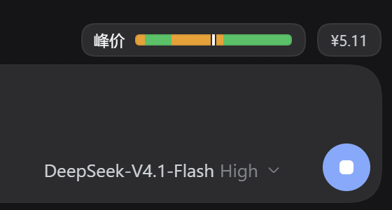
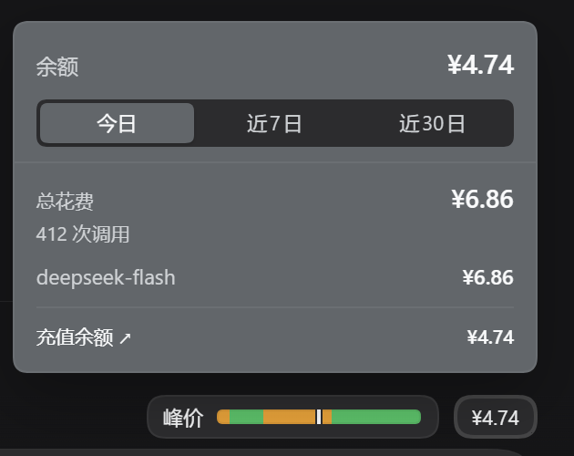
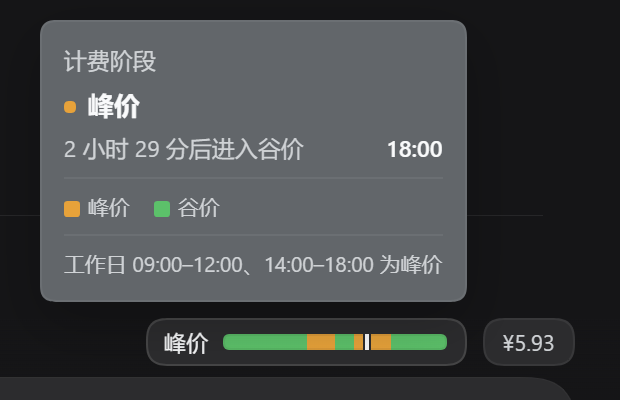

# dsh-billing-bar

A billing strip and the account balance, right above the DeepSeek Harness composer.
The strip covers the twelve hours centred on now and is coloured by the DeepSeek
peak / off-peak tariff, so the current phase and the shape of the next few hours
read at a glance. The balance sits beside it; hovering opens a panel with today's,
the last 7 days' and the last 30 days' spend per model.

[](screenshots/01-billing-strip.png)

## What it does

- **12-hour billing strip.** Six hours back, six hours ahead, drawn from the real
  tariff boundaries rather than hourly blocks, with a marker at the current time.
  Amber is peak, green is off-peak: weekdays 09:00–12:00 and 14:00–18:00 Beijing
  time, with weekends and Chinese statutory holidays off-peak all day.
- **Hover the strip** to read the current phase, how long is left in it, the exact
  time it flips, and a colour legend. The strip is hover-only — clicking it does
  nothing.
- **Hover the balance** to open the panel. It lists today, the last 7 days and the
  last 30 days: total cost, call count, a per-day bar chart for the multi-day
  ranges, and the cost of each model.
- **Click to pin.** Pressing the balance (or anywhere in the panel) keeps the panel
  open while you read it; a second press on the balance, a press outside, or Escape
  closes it. Moving the mouse away no longer dismisses it.
- **充值余额 is a link** to the official DeepSeek top-up page, taken from the account
  service rather than hard-coded.

| Balance panel | Phase tooltip |
| --- | --- |
|  |  |

## Install

```sh
# npm package
dsh plugin --profile web add dsh-billing-bar
# or straight from this repository
dsh plugin --profile web add github:Daaaaxianer/dsh-billing-bar
```

Then restart the harness. Requires DSH `0.2.x` (`engines.dsh` above) and, for
the balance, a signed-in DeepSeek account — without one the chip shows `—`.

## Where the numbers come from

| Value | Source |
| --- | --- |
| Peak / off-peak phase and the 12-hour strip | The published DeepSeek tariff schedule, computed locally |
| Balance, and the top-up URL | The harness `deepseekAccount` service (`getBalance`, `getState().links`) |
| Spend | `assistant/message` usage in this machine's session logs, priced at the list rates |
| Rates | DeepSeek list prices in CNY per million tokens: `deepseek-flash` and `deepseek-v4-pro`, off-peak is half of peak |

**Spend is a local estimate.** It counts text tokens of sessions on this machine
only; Search / Fetch requests billed per call are not included, and models without
a published price (anything that is not a DeepSeek model) are reported as
"unpriced" instead of being guessed at. The provider's own bill remains the
authority.

## How it is built

- `index.js` — the host half. It registers one read-only route,
  `GET /dsh-billing-bar/status?range=today|7d|30d`, on the harness `webServer`
  (loopback only) and answers with the phase, the 12-hour segments, the balance and
  the requested range. Usage is folded from session logs that changed inside the
  window — about 0.3 s for 30 days — and cached per range for 30 / 90 / 180 s.
- `client.js` — the client half. It registers one entry in
  `conversation.input.dock`, aligns itself to the composer card with that card's own
  CSS variables, and only renders: it reads no DOM outside its own element and adds
  no click target to the strip.

No telemetry, no network access beyond the account service, and no writes outside
the plugin's own memory.

## Maintaining it

- `HOLIDAYS` at the top of `index.js` holds the Chinese statutory holidays. Append
  the next year's dates when the State Council notice is published.
- `PRICE_CLASSES` holds the list prices as `[off-peak, peak]` in CNY per million
  tokens.
- `WINDOW_SIDE_MS` is half of the strip window (6 hours by default).

## License

MIT — see [LICENSE](LICENSE).

---

# 中文说明

在 DeepSeek Harness 输入框右上角显示一条计费状态：**以当前时刻为中心的 12 小时
峰谷条** + **账户余额**。

- **峰谷条**：前 6 小时 → 现在 → 后 6 小时，按真实峰谷边界连续上色（琥珀=峰价，
  绿色=谷价），竖线标出当前时刻。
- **悬停峰谷条**：显示当前阶段、还有多久切换、切换时刻与颜色图例。峰谷条只响应
  悬停，点击无动作。
- **悬停余额**：展开面板，可切换今日 / 近 7 日 / 近 30 日，显示总花费、调用次数、
  逐日柱状图与各模型花费。
- **点击固定**：点一下余额（或面板任意位置）面板会钉住，鼠标移开也不消失；再点
  一次余额、点面板外面或按 Esc 才关闭。
- **充值余额** 是指向官方充值页的链接，地址来自账号服务 `links.topUpUrl`。

数据来源：余额与充值链接来自 harness 的 `deepseekAccount` 服务；花费来自本机会话
日志里的 `assistant/message` 用量，按官方人民币价目折算；峰谷时段按官方规则本地
计算。**花费是本地估算**——只含本机会话的文本 token，不含 Search / Fetch 按次计费，
非 DeepSeek 模型没有内置单价时会标注"未定价"而不猜价格。

安装：

```sh
dsh plugin --profile web add dsh-billing-bar
# 或直接从仓库安装
dsh plugin --profile web add github:Daaaaxianer/dsh-billing-bar
```

要求 DSH `0.2.x`；余额需要已登录 DeepSeek 账号，否则显示 `—`。

维护：`index.js` 顶部的 `HOLIDAYS` 是法定节假日表（次年放假通知发布后补日期），
`PRICE_CLASSES` 是单价表（`[谷价, 峰价]`，元/百万 tokens），`WINDOW_SIDE_MS` 是
条形窗口的半宽。

许可证：MIT。
